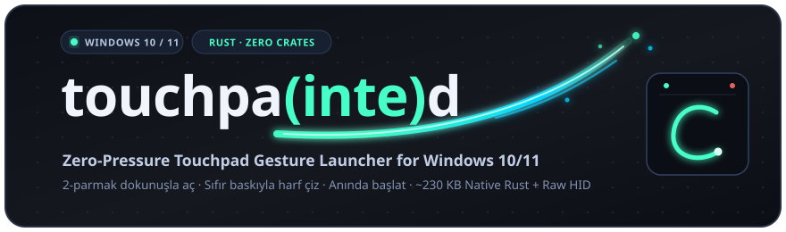

# touchpainted

<p align="center">
  
</p>

**touchpa(inte)d** (`touchpainted`), dizüstü bilgisayarınızın **Windows Precision Touchpad** yüzeyinde **1 veya 2 parmağınızla sıfır baskıyla** harf çizerek (`C`, `V`, `M`, `S`, `W` veya kendi öğrettiğiniz özel şekiller) uygulamaları, klasörleri ve web bağlantılarını anında başlatmanızı sağlayan, **sıfır harici bağımlılıklı (Zero-Dependency)** ultra hafif yerel bir Windows başlatıcısıdır.

---

## ✨ Öne Çıkan Özellikler

- **⚡ Ultra Hafif & Kesme (Interrupt) Odaklı Mimari:**
  - Tamamen **Rust** ile doğrudan Win32 (`user32.dll`, `gdi32.dll`, `shell32.dll`, `kernel32.dll`) ve Windows HID (`hid.dll`) FFI çağrıları kullanılarak yazılmıştır.
  - Harici crate/kütüphane indirmez, çevrimdışı derlenir; tek bağımsız çalıştırılabilir dosya (**~215 KB**) üretir ve boşta CPU tüketmez.
- **🖐️ Doğrudan Precision Touchpad (`0x000D:0x0005`) Ham HID Okuyucu:**
  - Touchpad'e **basmaya/tıklamaya gerek kalmadan (Sıfır Baskı)** 1 veya 2 parmağınızı yüzeyde hafifçe kaydırarak fosforlu çizim yapabilirsiniz.
  - **Delta-Centroid (Ortak Merkez) Motoru:** Yüzeye 2 parmak koyduğunuzda iki parmak arasına düz çizgi çekmez; parmak sayısı değişimlerini (`0 -> 1 -> 2 -> 1`) otomatik sönümler ve ortak ağırlık merkezini takip eder.
- **📐 Dinamik Auto-Fit Neon Tuval:**
  - Parmağınızı touchpad'in neresine koyarsanız koyun çizim merkezden başlar ve `C` gibi yukarı kavisli harfleri çizerken tuval sınırlarına çarpıp düzleşmez; kamera çiziminizi gerçek zamanlı ortalar.
- **🧠 Hibrit Tanıma Motoru (`Geometrik Sınıflandırıcı` + `$1 Unistroke`) & Canlı Kalibrasyon (`[🎯 Harf Öğret]`):**
  - El yazısı farklarına dayanıklı geometrik topoloji analizi ile oran koruyucu (`Uniform Scaling`) `$1 Unistroke` şablon eşleştiricisini birleştirir.
  - HUD üzerindeki **`[🎯 Harf Öğret (T)]`** butonuyla kendi el alışkanlığınızı doğrudan `config.json` içine kaydedebilirsiniz.
- **🛡️ Arka Plan İzolasyonu & Tek Kopya Koruması:**
  - Çizim ekranı (HUD) açıkken arka plandaki pencerelerde kaydırma (`WM_MOUSEWHEEL`) bloke edilir, imleç konumunuz korunur ve harici fare imlecini oynatmak yanlış çizime yol açmaz.
  - Sistem tepsisinde (System Tray) çalışır; tekrar çalıştırıldığında ikinci kopya açmak yerine mevcut pencereyi öne getirir.

---

## 🎮 Kullanım Kılavuzu

1. **Çizim Ekranını (HUD) Açma:**
   - Touchpad'e **2 parmakla hızlıca çift dokunun ("Tık-Tık")**, **VEYA**
   - Klavyeden **`Ctrl + Space`** kısayoluna basın, **VEYA**
   - Sağ alt **Sistem Tepsisi (System Tray)** ikonuna sol tıklayın.
2. **Harf Çizme (Sıfır Baskı):**
   - Açılan koyu temalı neon ekranda hiçbir tuşa basmadan touchpad üzerinde **1 veya 2 parmağınızı kaydırarak** harfi çizin (`C`, `V`, `M`, `S`, `W`).
   - Parmağınızı yüzeyden kaldırdığınız anda (`~80–280 ms`) harf otomatik tanınır ve ilgili uygulama başlatılır.
3. **Kendi El Yazınızı Öğretme (Kalibrasyon Modu):**
   - HUD açıkken klavyeden **`T`** tuşuna basın veya üst bardaki **`[🎯 Harf Öğret (T)]`** butonuna tıklayın.
   - Klavyeden öğretmek istediğiniz harfe basın (ör. `C`, `V`, `M`).
   - Touchpad üzerinde harfi kendi doğal el hareketinizle bir kez çizin. Şablonunuz `config.json` dosyasına kaydedilir.
4. **Kapatma:**
   - Klavyeden **`ESC`** tuşuna basın, sağ üstteki **`[✕]`** butonuna tıklayın veya hareketsizlik süresinin (`idle_timeout_ms`) dolmasını bekleyin.

---

## ⚙️ Yapılandırma (`config.json`)

Uygulama çalışma dizinindeki [`config.json`](config.json) dosyasını okur (dosya yoksa otomatik oluşturur). İstediğiniz harfe herhangi bir `.exe` uygulamasını, klasör yolunu, Windows URI şemasını (`ms-settings:`) veya `https://...` web bağlantısını bağlayabilirsiniz:

```json
{
  "idle_timeout_ms": 4000,
  "gestures": [
    {
      "letter": "C",
      "name": "Hesap Makinesi",
      "app": "calc.exe",
      "param": "",
      "custom_points": []
    },
    {
      "letter": "V",
      "name": "Dosya Gezgini",
      "app": "explorer.exe",
      "param": "",
      "custom_points": []
    },
    {
      "letter": "M",
      "name": "Çizim Tuvali",
      "app": "mspaint.exe",
      "param": "",
      "custom_points": []
    },
    {
      "letter": "S",
      "name": "Ayarlar",
      "app": "ms-settings:",
      "param": "",
      "custom_points": []
    },
    {
      "letter": "W",
      "name": "Not Defteri",
      "app": "notepad.exe",
      "param": "",
      "custom_points": []
    }
  ]
}
```

---

## 🛠️ Derleme ve Çalıştırma

### Gereksinimler
- **İşletim Sistemi:** Windows 10 veya Windows 11 (x64)
- **Derleyici:** Rust (`rustc 1.85+`, MSVC toolchain) — Harici crate/paket indirmez, çevrimdışı derlenir.

### Komutlar
```powershell
# Release profilinde optimize edilmiş bağımsız .exe üretimi:
cargo build --release

# Çalıştırma:
.\target\release\touchpainted.exe
```

*(Tanılama logları için çalıştırırken `--log` parametresi ekleyebilirsiniz; bu durumda çalışma klasörüne `touchpad_log.txt` yazılır.)*

---

## 📐 Mimari Özeti

| Katman | Teknoloji / API | Görev |
| :--- | :--- | :--- |
| **Donanım HID Katmanı** | `RegisterRawInputDevices` (`0x000D:0x0005`) + `hid.dll` (`HidP_GetValueCaps`, `HidP_GetUsages`, `HidP_GetUsageValue`) | Touchpad yüzeyindeki 5 parmağa kadar `Tip Switch` ve `X/Y` koordinatlarını çalışma zamanında otomatik keşfeder ve okur. |
| **İzolasyon Kalkanı** | `SetWindowsHookExW(WH_MOUSE_LL)` | 2-parmak çift tık yedek algılamasını yapar ve HUD açıkken arka plan kaydırmalarını (`WM_MOUSEWHEEL`) bloke eder. |
| **Hareket & Kamera Motoru** | `Delta-Centroid` + `Auto-Fit Viewport` | Parmak değişim sıçramalarını filtreler ve çizimi tuval sınırlarına çarptırmadan merkeze izdüşürür. |
| **Tanıma Motoru** | `compute_geometric_scores` + `$1 Unistroke` (`64-point Uniform Resample`) | Hem topolojik geometri kuralları hem de açısal şablon benzerliğiyle `%` eşleşme skoru üretir. |
| **Arayüz & Sistem Tepsisi** | Win32 GDI Double-Buffered `BitBlt` + `Shell_NotifyIconW` | Titremesiz (flicker-free) fosforlu çizim tuvali ve sağ alt sistem tepsisi menüsü sunar. |

---

## 📄 Lisans (Ticari Kullanıma Kapalı)

Telif Hakkı © 2026 **TunahanBasri**. Tüm ticari hakları saklıdır.

Bu proje **[Ticari Olmayan Kişisel Kullanım Lisansı](LICENSE)** kapsamındadır:
- ✅ **Kişisel Kullanım Serbest:** Bireysel ve eğitim amaçlı ücretsiz kullanabilir, inceleyebilir ve kendi bilgisayarınız için derleyebilirsiniz.
- ❌ **Ticari Kullanım ve Satış Yasak:** Yazılımın, kaynak kodunun veya türevlerinin **satılması, ücretli dağıtılması veya ticari ürünlerde kullanılması** kesinlikle yasaktır.
