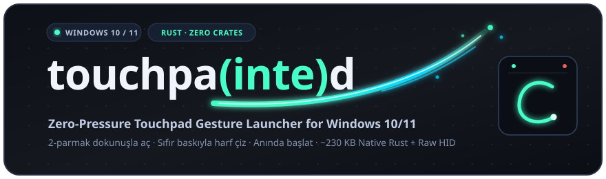
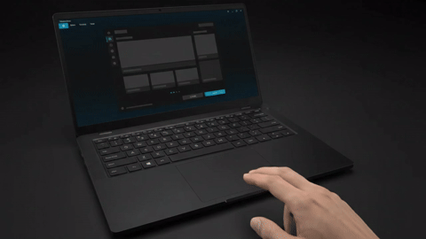

# touchpainted

<p align="center">
  
</p>

<p align="center">
  <a href="README.md">English</a> ·
  <a href="https://github.com/TunahanBasri/touchpainted/releases/latest">İndir</a>
</p>

touchpainted, Precision Touchpad'i harf çizerek uygulama açılan bir başlatıcıya dönüştüren küçük bir Windows sistem tepsisi uygulamasıdır. Touchpad'e iki parmakla çift dokunun, bastırmadan bir veya iki parmakla bir harf çizin; o harfe bağlı program açılır.

Rust ile, hiçbir harici crate kullanılmadan yazılmıştır. Win32 ve Windows HID ayrıştırıcısını (`hid.dll`) doğrudan çağırır. Release derlemesi yaklaşık 230 KB'lık tek bir çalıştırılabilir dosyadır.

<p align="center">
  
</p>

## Özellikler

- **Ham touchpad verisi.** Precision Touchpad raporlarını (HID usage page `0x0D`, usage `0x05`) doğrudan okur. Bu sayede iki parmakla yapılan çizim, Windows tarafından kaydırmaya çevrilmeden yakalanır.
- **Bastırmak gerekmez.** Bir veya iki parmağı yüzeyde kaydırmak yeterlidir; tıklama veya sürükleme gerekmez.
- **Kararlı iki parmak çizimi.** Hareket, parmakların ortak merkezindeki değişimden hesaplanır. İkinci parmak değdiğinde veya kalktığında çizgi yeni merkeze sıçramaz.
- **Otomatik sığdırma.** Noktalar sınırsız koordinatlarda tutulur ve çizim alanına ortalanıp ölçeklenir. Kenara yakın kavisler düzleşmez.
- **Tanıma.** Yerleşik harfler (`C`, `V`, `M`, `S`, `W`) basit geometrik kurallar ve [$1 Unistroke](https://depts.washington.edu/acelab/proj/dollar/index.html) şablon eşleştiricisiyle (64 noktaya yeniden örnekleme, ±24° döndürme taraması) puanlanır.
- **Harf öğretme.** `A`–`Z` arasındaki herhangi bir harfi kendi çiziminizle kaydedebilirsiniz. Şablon `config.json` dosyasına yazılır ve eşleştirmede öncelik alır.
- **Olay güdümlü.** Sürekli dönen bir tarama döngüsü yoktur. Uygulama `GetMessageW` içinde bekler; touchpad girdisi, düşük seviye fare kancası olayları ve pencere açıkken kendi zamanlayıcılarıyla uyanır.
- **Tek kopya.** Uygulama tekrar çalıştırıldığında ikinci bir kopya açılmaz, çalışan pencere öne gelir.

## Gereksinimler

- Windows 10 veya 11, x64.
- Hareketle kullanım için Precision Touchpad. Touchpad yoksa pencere `Ctrl+Space` ile açılabilir ve çizim alanında sol tuş basılı tutularak fareyle çizilebilir.

## Kullanım

1. [Releases](https://github.com/TunahanBasri/touchpainted/releases/latest) sayfasından `touchpainted.exe` dosyasını (veya zip'i) indirip çalıştırın. Kurulum gerektirmez, sistem tepsisinde çalışır. İlk açılışta `.exe`'nin yanına `config.json` oluşturulur.
2. Pencereyi açmak için touchpad'e iki parmakla çift dokunun, `Ctrl+Space` tuşlarına basın veya tepsi simgesine sol tıklayın.
3. Harfi çizip parmaklarınızı kaldırın. Bağlı program açılır ve pencere kapanır.
4. Hiçbir şey açmadan kapatmak için `Esc` tuşuna basın, kapatma düğmesine tıklayın veya bekleme süresinin dolmasını bekleyin.

### Harf öğretme

Pencere açıkken `T` tuşuna basın veya başlık çubuğundaki öğretme düğmesine tıklayın. Pencerenin altındaki düğmelerden bir harf seçin ya da `A`–`Z` tuşlarından birine basın, ardından harfi bir kez çizin. Çizim normalize edilip `config.json` dosyasına yazılır.

## Yapılandırma

`config.json` içindeki her kayıt, bir harfi `ShellExecuteW` ile açılabilecek bir hedefe bağlar: program, klasör, `ms-settings:` gibi bir URI veya `https://` adresi.

```json
{
  "idle_timeout_ms": 4000,
  "gestures": [
    { "letter": "C", "name": "Hesap Makinesi", "app": "calc.exe",     "param": "", "custom_points": [] },
    { "letter": "V", "name": "Dosya Gezgini",  "app": "explorer.exe", "param": "", "custom_points": [] },
    { "letter": "M", "name": "Çizim Tuvali",   "app": "mspaint.exe",  "param": "", "custom_points": [] },
    { "letter": "S", "name": "Ayarlar",        "app": "ms-settings:", "param": "", "custom_points": [] },
    { "letter": "W", "name": "Not Defteri",    "app": "notepad.exe",  "param": "", "custom_points": [] }
  ]
}
```

| Alan | Anlamı |
| :--- | :--- |
| `idle_timeout_ms` | Hareketsizlikte pencerenin kapanma süresi. Öğretme modunda en az 12 saniye beklenir. |
| `letter` | Çizilecek harf. |
| `name` | Pencerede gösterilen ad. |
| `app` | Açılacak program, klasör, URI veya adres. |
| `param` | İsteğe bağlı komut satırı parametreleri. |
| `custom_points` | Öğretme modunun yazdığı normalize şablon. Boş bırakılırsa yerleşik tanıyıcı kullanılır. |

Yapılandırma dosyası tepsi menüsünden de açılabilir.

## Derleme

Rust 1.85 veya üzeri (edition 2024) ve MSVC araç zinciri gerekir. İndirilecek bağımlılık yoktur.

```powershell
git clone https://github.com/TunahanBasri/touchpainted.git
cd touchpainted
cargo build --release
.\target\release\touchpainted.exe
```

Tanılama çıktısını `.exe`'nin yanındaki `touchpad_log.txt` dosyasına yazmak için `--log` parametresiyle çalıştırın.

## Nasıl çalışır

| Bölüm | Uygulama |
| :--- | :--- |
| Touchpad girdisi | `RegisterRawInputDevices` ile `HidP_GetValueCaps`, `HidP_GetUsages`, `HidP_GetUsageValue`. Parmak kanalları ve X/Y aralıkları çalışma anında okunur, sabit yazılmaz. |
| Dokunma yedeği ve kaydırma engeli | `WH_MOUSE_LL` düşük seviye fare kancası. Kanca yalnızca mesaj bırakır ve hemen döner. |
| Çizgi takibi | Ortak merkez değişimleri sınırsız sanal koordinatlarda biriktirilir. |
| Tanıma | Geometrik kurallar ve `$1 Unistroke` eşleştirme. |
| Çizim | Çift tamponlu GDI, `Shell_NotifyIconW` ile tepsi simgesi. |
| Başlatma | `ShellExecuteW` arka plan iş parçacığında çalışır, girdi iş parçacığını bekletmez. |

## Bilinen sınırlamalar

- Arayüz metinleri yalnızca Türkçedir.
- Yerleşik tanıyıcı `C`, `V`, `M`, `S`, `W` harflerini kapsar. Diğer harfler öğretildikten sonra çalışır.
- İki parmakla çift dokunma algılaması touchpad sürücüsüne bağlıdır. Cihazınızda güvenilir değilse `Ctrl+Space` kullanın.
- Çalıştırılabilir dosya imzalı değildir; ilk açılışta SmartScreen uyarısı çıkabilir.

## Lisans

Telif Hakkı © 2026 TunahanBasri. [Ticari olmayan kişisel kullanım lisansı](LICENSE) ile yayınlanmıştır.

Kişisel ve eğitim amaçlı kullanım, kaynak kodu inceleme ve kendiniz derleme serbesttir. Yazılımı satmak, ücretli dağıtmak veya ticari bir ürüne eklemek yazılı izin gerektirir.
